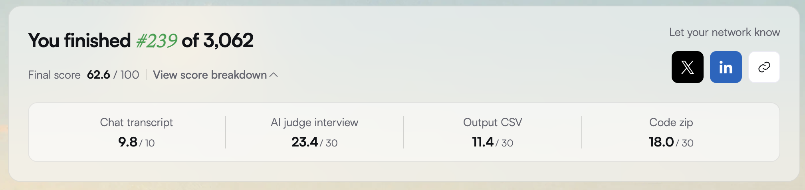
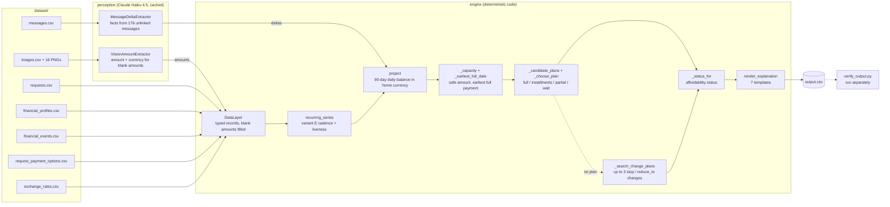

<div align="center">

# buy-or-wait-agent

**"Can I afford this?" A deterministic 90-day cash-flow simulator that decides pay in full, pay partially, installments, wait or don't buy, with Claude Haiku 4.5 reading images and messages.**

[](#result)
[](#result)
[](#result)
[](code)

[](#run-it)
[](#how-it-works)
[](#how-it-was-built)
[](#how-it-was-built)
[](LICENSE)

</div>

For each purchase request, the pipeline:
1. rebuilds the user's finances from balances, transactions, payment options, messages and images;
2. forecasts the balance day by day for 90 days, protecting essential spending and the user's minimum balance;
3. chooses pay in full, pay partially, installments, wait or not proceed, plus up to three spending changes and a short explanation.

Built solo in 24 hours for **HackerRank Orchestrate (September 2026)**, challenge "Buy or Wait?". Full spec: [`problem_statement.md`](https://github.com/interviewstreet/hackerrank-orchestrate-september26/blob/main/problem_statement.md) in HackerRank's starter repo.

## Result

**#239 of 3,062 participants (top 7.8%), final score 62.6/100.**



Exact-match accuracy on the 25 labelled sample rows (`python3 code/evaluation/score_fields.py`):

| Field | Exact |
|---|---|
| `amount_safe_to_pay` | 2 / 25 |
| `affordability_status` | 16 / 25 |
| `recommended_payment_method` | 18 / 25 |
| `payment_plan` | 14 / 25 |
| `earliest_date_for_full_payment` | 10 / 25 |
| `spending_changes_needed` | 22 / 25 |
| `decision_explanation` | 8 / 25 |

The next edition's solution (October 2026, 79.4 / 100, rank 56 of 4,090) is at [GodVilan/deletion-audit-agent](https://github.com/GodVilan/deletion-audit-agent).

## Dataset (not included)

The challenge data and problem statement belong to HackerRank and aren't redistributed here. To run the pipeline, get the challenge repository and copy its `dataset/` folder to the repo root:

```bash
git clone https://github.com/interviewstreet/hackerrank-orchestrate-september26.git
cp -r hackerrank-orchestrate-september26/dataset ./dataset
```

## Run it

Python 3.10+, standard library only. The run needs `dataset/` (above) and an Anthropic API key:

```bash
export ANTHROPIC_API_KEY="<your-key>"
python3 code/main.py                    # writes output.csv (250 rows)
python3 code/verify_output.py           # structural and cross-field checks
python3 code/evaluation/score_fields.py # accuracy on the 25 labelled rows
python3 code/test_schema.py && python3 code/test_explanations.py
```

- Each image and message is sent to the model once, and the result is cached in `.vision_cache/` and `.message_delta_cache/` (192 calls in total, about $0.27). After that, runs make no model calls and need no key.
- With no key and no cache, the run stops at the first image it needs to read.
- Extraction runs at temperature 0, but model output can still vary between runs, so a fresh run may not exactly reproduce the predictions that were scored.

## Architecture



## How it works

A deterministic 90-day cash-flow simulator with a narrow LLM perception layer. Claude Haiku 4.5 (`claude-haiku-4-5-20251001`) does two things only:

1. **Vision:** reads the amount and currency from the 16 images behind blank `amount` cells.
2. **Message deltas:** turns the 176 messages not linked to any event (mostly from employers) into structured facts (salary changes, ended income, expense changes, confirmed income).

Python does everything else: event reconstruction, exchange-rate conversion, recurrence detection, the day-by-day balance forecast, safe-amount calculation, plan and installment construction, spending-change search, ranking, explanations and output validation. The model never chooses a decision.

Cold-run cost: 192 model calls, 236,124 tokens, **$0.27** in total ([`code/evaluation/usage_report.md`](./code/evaluation/usage_report.md)). Module-level design notes are in [`code/README.md`](./code/README.md).

## What went wrong

- **Salary dates drifted.** Most salary credits settle on the 15th (1,154 of 1,690), but recurrences were projected on a ~30-day step (08-15 → 09-14 → 10-14), so earliest-payment dates landed a day off.
- **Income went missing.** 5 of 25 sample users had no salary series detected, which produced false `not_affordable` rows.
- **Wrong selection metric.** The recurrence variant was chosen on mean absolute error pooled across INR, IDR, EUR, ZAR and USD, so the 5 IDR rows, with amounts in the millions, decided it. Exact match per field would have measured accuracy.
- **Forecast not conservative enough.** Spending changes appear on 2% of output rows against 12% of the sample.
- **Not an agent.** The judges' code feedback was that the model never controls what happens next: it only extracts, and code makes every decision.
- **The submitted zip didn't run as documented.** The caches were zipped inside `code/`, but the code reads them from the repo root, so a run without a key failed.

## How it was built

All code was written with **HackerRank Pair**, HackerRank's browser-based agentic development environment, which I used through early beta access for this edition. Planning and review were done with Claude. [`log.txt`](log.txt) is the complete development transcript from Pair, with every prompt verbatim (secrets redacted); its entries are tagged `tool=HackerRank coding agent`.

## What's in this repo

| Path | What it is |
|---|---|
| `code/` | The solution, byte-identical to the submitted `code.zip` minus its bundled caches. `code/README.md` is the submitted version, so it still mentions those caches. |
| `log.txt` | The graded development transcript from Pair |
| `img/score.png` | The official scorecard |

## License

The code is released under the [MIT License](LICENSE). The challenge materials (dataset, problem statement and agent instructions) are © HackerRank and aren't covered by this license.
